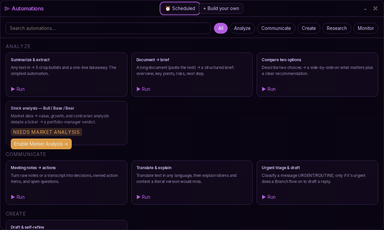
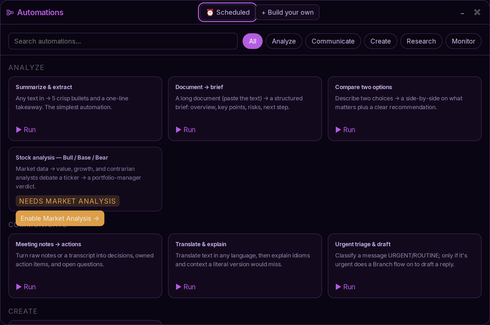
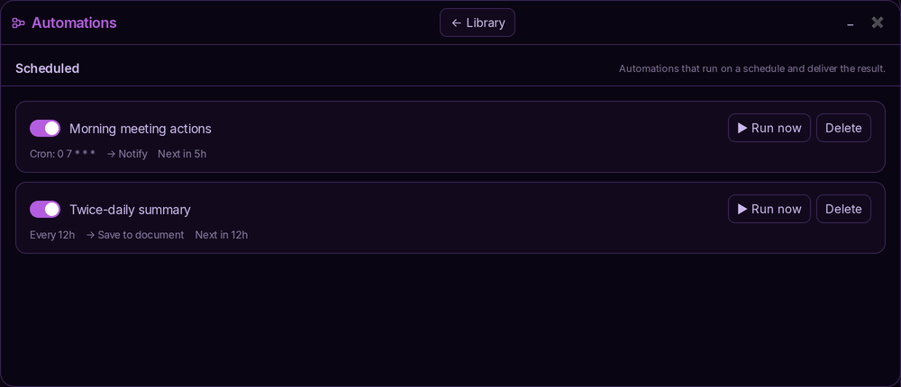
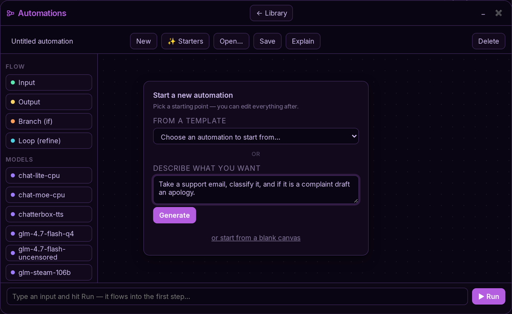

# Automations — run, schedule, build

Automations are small workflows that chain your local tools and models together.
You can **run** a ready-made one in a click, **schedule** it so it runs by itself
and delivers the result, or **build** your own — no node-wiring required to get
started.

Open Automations from the sidebar (or the `/automations` command).

> **Renamed.** This feature used to be called *Recipes*. It was renamed when the
> [Kitchen](reader.md) arrived, so that "recipe" only ever means food. The old
> `/recipes` command still opens it, and the code and API paths still say
> `recipes` (`src/recipes.py`, `/api/recipes/…`).

---

## Run an automation

Automations opens to a **library** of one-click workflows, grouped by what they
do — Analyze, Communicate, Create, Research, Monitor. Search or pick a category,
then click a card.

Each card opens a simple panel: the sample input is pre-filled and the expected
output is shown. Type your input, hit **Run**, and the result streams in — no
graph, no wiring.

Some automations need a toolbox (e.g. *Stock analysis — Bull / Base / Bear* needs
the Market tools). If it's off, the card shows an **Enable** button; one click
turns the toolbox on, runs a quick check that its tools respond, and the
automation becomes runnable. You can turn it back off any time in the MCP panel.

**Who can run them:** anyone signed in can run the ready-made ones. Building your
own stays admin-only, since a hand-built automation can call tools and the shell.

---

## Schedule it

Any automation can run by itself. In its run panel, click **⏰ Schedule** and
choose:

- **When it runs** — *Daily at* a time, *Every N hours*, a *custom cron*, or
  *When new email arrives*.
- **Where the result goes** — an in-app **notification** (the default), or saved
  to a **document** or **note**.

What you have scheduled lives under **⏰ Scheduled** — each with an on/off
switch, its schedule, the next and last run, a run-now button, and the last
result. The same automations also appear in the sidebar's **Scheduled** list,
beside the scheduled tasks: everything that runs by itself is in one place,
with *Pause*, *Run now* and *Edit* on each row.

A time in a schedule is the time on the server's own clock: *Daily at 7:00*
runs at seven in the morning where the server is. (It used to be read as
UTC.) When a run finishes, the result goes to your phone as well, if you have
turned notifications on.

A couple of things worth knowing:

- **Email-arrives** schedules poll your inbox every few minutes and fire when
  new mail lands; they baseline on the first check, so they never fire on your
  existing backlog.
- The **Inbox declutter** automation *proposes* unsubscribes ranked by volume,
  each with its unsubscribe link — it never unsubscribes for you. You decide.
- Schedules run in-process; disable them with `AEGIS_INPROCESS_TASKS=0` if you
  drive scheduling externally.

---

## Build your own

Click **+ Build your own** to open the editor. It never starts blank — a *Start a
new automation* card offers three ways in:

- **From a template** — load any library automation and tweak it.
- **Describe what you want** — type a plain sentence (e.g. *"Take a support email,
  classify it, and if it's a complaint draft an apology"*) and a local model drafts
  the node graph for you. Edit from there.
- **Blank canvas** — drop nodes from the left palette and wire them yourself.

Nodes come in a few kinds: **input** (the run input), **tool** (calls a tool),
**model** (runs a prompt), **output** (the result), plus **branch** (conditional)
and **loop** (refine). A model node automatically receives every upstream node's
output as context, so you rarely need placeholders — when you do, `{{input}}` is
the run input and `{{nodeId}}` is another node's output.

Not sure what a workflow does? Hit **Explain** for a plain-English summary
generated from the graph. **Save** to keep it (it then shows up in *Open…*), and
**Run** to try it with an input.

---

## Under the hood

Automations execute server-side in topological order; every node runs against
your local models and tools, and nothing leaves the machine. The ready-made ones
are a curated catalog; schedules are stored as JSON under `data/jobs/` and fired
by a small poll loop. See the source in `src/recipes.py`,
`src/recipe_templates.py`, `src/jobs.py`, and `src/recipe_authoring.py`.
