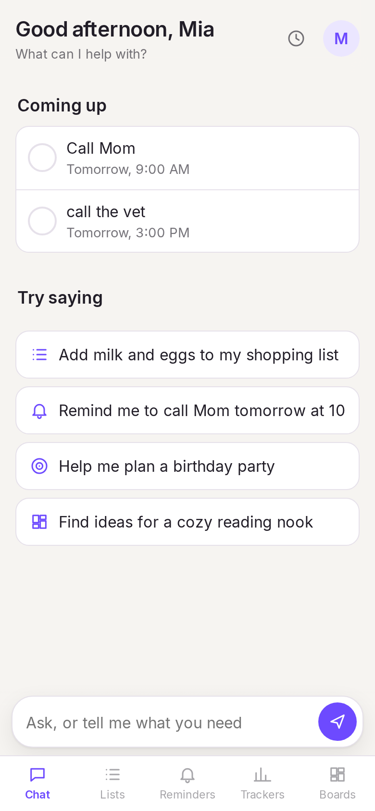
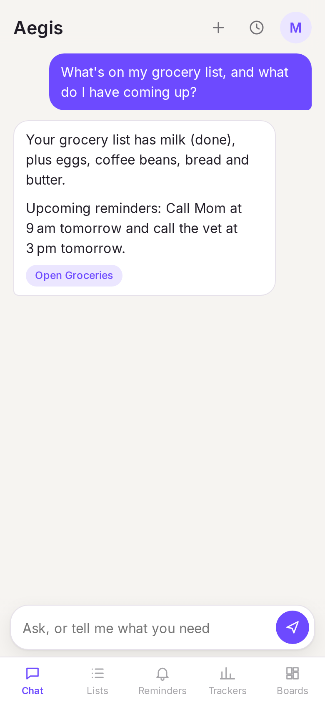
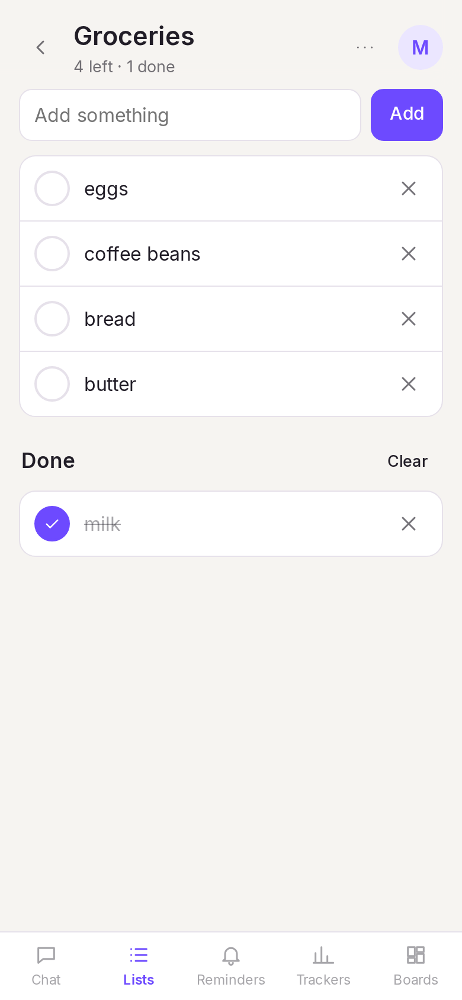
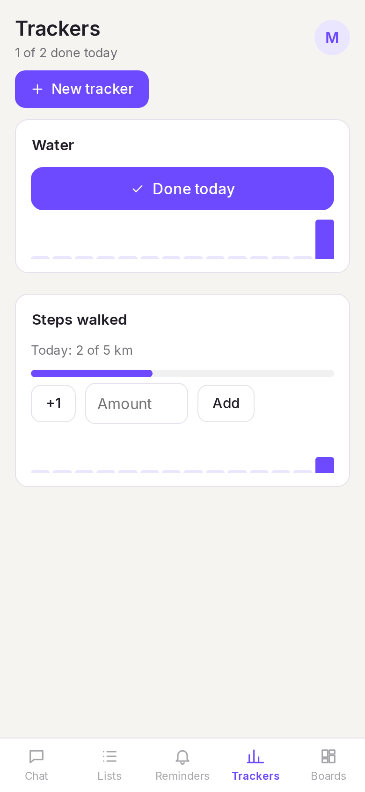

# Home: the simple screen

For someone who wants help with everyday things and does not want an "AI
workspace": one screen on their phone with a chat box and four things —
lists, reminders, trackers and boards. No models, modes, agents or settings.

Everyone who does not run the server gets this screen: the **Member** and
**Household** roles both land on `/home` when they sign in. An administrator
can give one person the full app instead under
[People and access](memory-and-users.md#people-roles-and-each-persons-app) —
with the workshop's tools still out of their reach — and can use this screen
themselves: the house button in the full app, and *Switch to the workshop* in
this screen's account menu, go back and forth.

  
  
  
  

## What it does

**Chat.** They say what they need in their own words:

> *Add bread and butter to my groceries, and remind me to call the vet tomorrow at 3.*
> *I drank two glasses of water — start tracking that, eight a day.*
> *What's on my packing list?* · *Help me plan Emma's birthday.*
> *Find ideas for a cozy reading nook and pin the best ones.*

The assistant does it — it does not explain how — and answers in a sentence,
with a button to open whatever it just changed. It is told who it is talking
to and how (their name, the note the administrator wrote about them), to use
plain language, and never to talk about how it works.

**Photos.** The camera button takes a photo (or picks one from the phone),
and that is all the person does. The photo is sorted for them: a living thing
is identified against the offline library — the name, how sure, the
dangerous lookalike, what the library says about eating or touching it —
print is read (and put into the household's language when it is in another),
and anything else is described. If the sorting was wrong, the answer has a
button for each other reading (*It is a label: read it*, *It is a plant or an
animal*, *Just describe it*). Words typed with the photo ("is this ready to
pick?") go with it.

**Speaking.** The microphone takes the question by voice and the answer is
read back. What is said goes to the home server's own speech recognition when
it has one — nowhere else, and it works with the internet down; the phone's
built-in dictation is used only when the server cannot hear. Listening stops
by itself when the talking stops.

**Lists and plans.** Shopping, packing, to-do. Tick things off, add several
at once ("milk, eggs, coffee"), clear what is done. A *plan* is a list for
getting something done, usually written by the assistant from a goal.

**Reminders.** A line and a time, once or every day / week / month / year.
*In an hour*, *This evening*, *Tomorrow morning* are one tap. Done marks a
one-off finished and moves a repeating one to its next time.

**Trackers.** Follow something day by day: a habit ticked off, an amount that
adds up toward a daily goal, or a rating from 1 to 5. Each shows today, the
last two weeks and how many days in a row.

**Boards.** Pictures, links and notes collected around one idea. Add a photo
from the phone, paste a link (its title and picture are fetched), or write a
note. *Find ideas* asks the assistant to search and pin for you.

**What it knows about me** opens [`/mind`](memory-and-users.md#seeing-tracing-and-changing-it-mind):
the same full view of their memory everyone gets, with everything editable.

## Answers in the shape of the thing asked

A question one exact tool can answer is answered by that tool, with no model
round at all — *when does it get dark tonight*, *will it rain tomorrow*, *how
many cups in a quart*, *how many days until Christmas*, *how do I say "where
is the pharmacy" in Spanish*, *what's on my shopping list* — in well under a
second, and as a **card**: the forecast with its hours, the sun's times, the
conversion, the translation with a speaker button, the list. Anything the
quick lane does not read exactly goes to the assistant as before.

Two requests that need several tools at once are done as **one job with fixed
steps**, the same way every time:

- **Going out** — *plan a day hike for Saturday near Fernhollow*, *we're going
  camping this weekend*, *what should I pack for a fishing trip*. The sun's
  times, the forecast, what to watch for (chosen by rule from the forecast and
  the kind of outing, each with a page from the library's manuals), a packing
  list that is saved, and a reminder for the evening before — answered with a
  trip card. *It will be about 6 hours* or *make it Sunday* plans it again.
- **Dinner** — *what can I make with chicken and rice?*, *walk me through a
  recipe for pancakes*. The cookbooks in the library are searched, one recipe
  is chosen and set out in the [Kitchen](reader.md#kitchen) in its own words,
  what it needs beyond what was named is listed (and put on the shopping list
  when asked), and a start-by reminder is set when a time to eat was given.
  When no cookbook has it, that is said before anything from general knowledge.

The model is asked one narrow thing in each (what to pack; which recipe
fits); the steps themselves are code, so none is skipped.

**Waiting, sources and failure are said plainly.** A model that has to be
woken says so (*Waking up, about half a minute*). Under an answer is where it
came from: *Home library*, *The web, today*, *Worked out*, *From what you told
me*. A question that deserves a long look gets a *Dig deeper* button with a
time estimate, and the finished report comes to the phone. When something
fails there are two buttons: *Try again* and *Tell* the person who runs the
server, who then gets what was asked and the technical cause.

**Something always moves while an answer is on its way.** The waiting line
under the question has a mark that moves, what is going on in plain words
(*Reading your message…*, *Thinking…*, *Checking the library…*), and how long
it has been. While the model reads there is a bar, because that wait can be
measured: the model server reports how far it has read. While it thinks, the
latest line of what it is thinking is shown underneath, in grey; an answer that
took real thought keeps a quiet *Thought for 12 s* under it that opens the
whole of it. *Show what … is thinking* in the account sheet switches the
glimpse off for that phone. The full app does the same in its own chat: the
thinking streams in a small box that folds to *Thought for 12 s*, and the
switch is Settings → Appearance → *Show the thinking* (on for everyone; with
it off the box's header still moves while the model thinks, so a reply is
never a blank). The mark and the words come from one place,
`static/js/working.js`, so the two screens cannot drift apart.

**An answer can be read aloud.** The speaker on an answer reads it; an answer
to a spoken question is read by itself, and so is every answer once *Read
every answer aloud* is on (account sheet → *Reading aloud*). The voice is the
person's choice: the phone's own, or a voice recorded in the Studio that is
theirs to use — their own, if they have recorded one. A recorded voice takes a
while to prepare, and a line under the answer says how far along it is; see
[Studio](studio.md#voices-and-answers-read-aloud).

**Today at home.** The first screen shows today's forecast for the household's
home town, once an administrator has entered it under People and access →
Household (see [the Almanac](almanac.md#weather-and-the-household)).

## Reminders on the phone

Under the round button at the top right: **Turn on notifications**. After
that, reminders appear on that phone with the app closed.

- On an iPhone the page has to be added to the Home Screen first (Share →
  *Add to Home Screen*) and opened from there.
- It needs the internet at the moment the reminder fires: the message goes
  through the phone maker's notification service (Google, Apple, Mozilla),
  sealed so that only the phone can read it. With no internet the reminder
  still shows inside the app the next time it is opened.
- The server signs each message with its own key (`data/push_vapid.json`,
  created on first use). The contact address in that signature is the
  `push_contact` setting — a placeholder unless you set one.
- Without notifications turned on, reminders show under *Coming up* and as a
  banner while the app is open, and still go out through whatever the server
  is set up for (Settings → reminders: e-mail, ntfy, a webhook).

## How it fits with the rest

- **Lists and reminders are notes.** A list is a checklist note; a reminder
  is a note with a due time. They show up in the full app's Notes, and
  reminders ride on its existing delivery. Repeating reminders now move to
  their next time on the server, so they keep coming with no browser open.
  Repeats follow the server's clock, so a daily 8:00 stays 8:00 across a
  daylight-saving change.
- **Trackers and boards** have their own tables. Pictures are resized and
  stored in `data/home/pins/<account>/`, and served only to their owner.
- **Links are fetched safely**: through the same guarded fetcher the web
  tools use — public addresses only, re-checked on every redirect, size
  capped. Offline, a link is pinned without its picture.
- **Everything is per account.** One person's lists, reminders, trackers and
  boards are invisible to everyone else, administrators included.

## The assistant's tools

Five tools, available to any account whose role includes the *home* group
(Member and Household do; Guest does not):

| Tool | Does |
|---|---|
| `manage_lists` | `add` (creates the list if needed), `check`, `uncheck`, `remove`, `show`, `list`, `clear_done`, `rename`, `delete` |
| `manage_reminders` | `add` (`when` in words or ISO, optional `repeat`), `list`, `done`, `snooze`, `update`, `delete` |
| `manage_trackers` | `create` (`check` / `number` / `scale`), `log`, `show`, `list`, `delete` |
| `manage_boards` | `pin` (links or a note; creates the board if needed), `create`, `show`, `list`, `delete` |
| `manage_kitchen` | `save` a recipe (its text, or a link) set out for cooking — kept as written, measures worked out for today, steps to follow one at a time; `show`, `list`, `delete`. See [Reader and Kitchen](reader.md#kitchen) |

The home screen also opens the **Kitchen** (recipes to follow step by step)
and the **Reader** (read and highlight from the offline library): the two
buttons under *More* on the first screen, and in the account menu.

They find a list, tracker or board by the name the person uses ("the grocery
list" finds *Groceries*). They work in the full app's agent mode as well.

## API

All under `/api/home`, scoped to the signed-in account; the browser sends its
time zone with each request.

| | |
|---|---|
| `GET /start` | name, sections, look, what is due, counts |
| `GET/POST /lists`, `GET/PUT/DELETE /lists/{id}` | lists |
| `POST /lists/{id}/items`, `PUT/DELETE /lists/{id}/items/{item}`, `POST /lists/{id}/clear-done` | items |
| `GET/POST /reminders`, `PUT/DELETE /reminders/{id}`, `POST /reminders/{id}/snooze` | reminders |
| `GET/POST /trackers`, `GET/PUT/DELETE /trackers/{id}`, `POST /trackers/{id}/log` | trackers |
| `GET/POST /boards`, `GET/PUT/DELETE /boards/{id}` | boards |
| `POST /boards/{id}/pins` `{url}` or `{text}`, `POST /boards/{id}/pins/upload` | pin a link, a note, a picture |
| `PUT/DELETE /pins/{id}`, `GET /pins/{id}/image[?thumb=1]` | pins |
| `GET /today` | today's forecast at home, for the first screen |
| `POST /problem` | tell whoever runs the server that an answer failed (they get the question and the cause) |
| `GET /reports` | this person's finished reports |
| `GET /api/push/key`, `POST /api/push/subscribe`, `/unsubscribe`, `/test` | phone notifications |

## Code

| Piece | Where |
|---|---|
| Lists, reminders, trackers, boards | `services/home/` |
| API | `routes/home_routes.py`, `routes/push_routes.py` |
| Tools | `src/agent_tools/home_tools.py` |
| Notifications | `services/push.py`, `static/lite/home-sw.js` |
| The screen | `static/home.html`, `static/lite/home.js`, `static/lite/home.css`, `static/lite/speech.js` |
| Answers with no model round | `services/direct.py` |
| Going out, Dinner | `services/outing.py`, `services/dinner.py`, `services/smart_tools.py` |
| Photo sorting | `services/identify/` |
| Waiting, sources, telling people | `services/waiting.py`, `services/search/origin.py`, `services/notify.py` |
| A card in words, for the full app | `services/cards.py` |
| Shared look and helpers for the standalone pages | `static/lite/lite.css`, `static/lite/lite.js` |

Not there yet: sharing a list between two accounts; drag to reorder.
