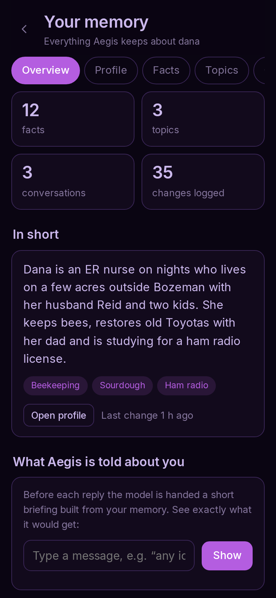
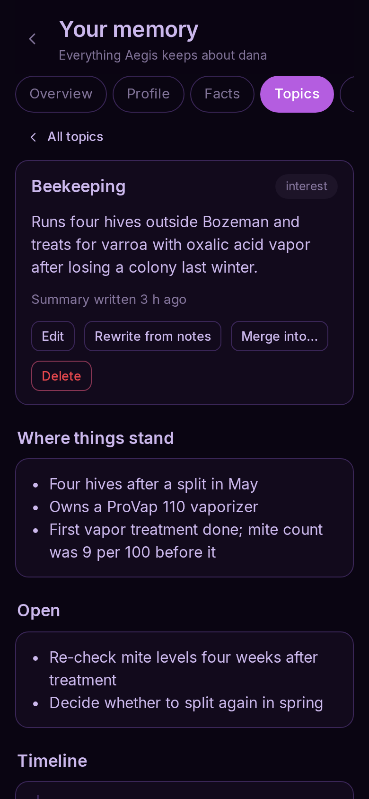
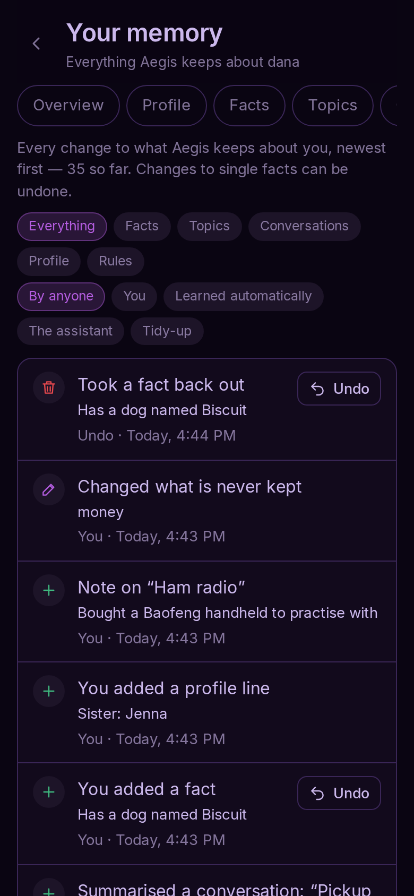
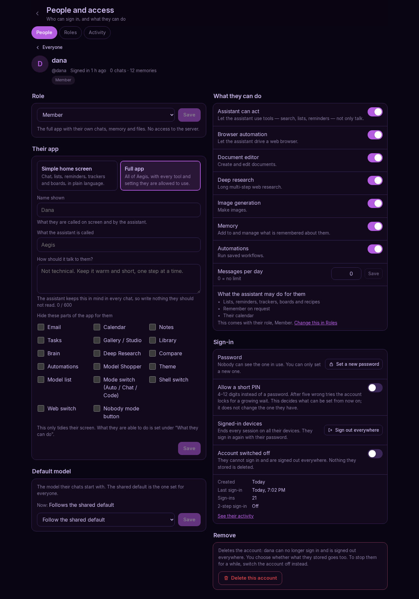

# Memory, and more than one person

Aegis remembers who it is talking to, in depth, and shows you all of it. Each
account has its own memory; nothing crosses from one account to another, and
an administrator cannot read anyone else's.

- [What is kept](#what-is-kept)
- [How it stays current](#how-it-stays-current)
- [What the model is given](#what-the-model-is-given)
- [Seeing, tracing and changing it: `/mind`](#seeing-tracing-and-changing-it-mind)
- [Nobody mode and the switches](#nobody-mode-and-the-switches)
- [`/me`](#me)
- [People, roles and each person's app](#people-roles-and-each-persons-app)
- [Signing in](#signing-in)
- [API](#api)
- [Where it lives](#where-it-lives)

## What is kept

Four layers, from single facts to the whole picture:

| Layer | What it is | Example |
|---|---|---|
| **Facts** | Single lasting statements, each with the words you said that showed it and the chat it came from. | *Keeps bees, four hives* — you said: "I'm up to four hives now" |
| **Topics** | One dossier per subject in your life — a hobby, a project, a person, your home. Every chat that touches it adds dated notes; a digest (summary, where things stand, timeline, open questions) is rewritten from the notes. | **Beekeeping**: 7 notes · "Runs four hives and treats for varroa with oxalic acid vapor after losing a colony last winter." |
| **Conversations** | A short digest of each chat: what you wanted, what came of it, what you said you would do. | *Hive split and mite treatment* — "Reported four hives after a May split…" |
| **Profile** | The standing picture written from all of the above: who you are, people, preferences, interests, projects, goals, and patterns Aegis has noticed (marked as its own inference). | |

Facts have a kind — `identity`, `preference`, `interest`, `contact`,
`project`, `goal`, `fact`, `event`, `task` — and may be marked as sensitive
(`health`, `money`, `location`, `relationships`, `work`, `beliefs`).

## How it stays current

After the first exchange of a chat, then every second exchange, and at once
when you say something like *"remember that…"* or *"from now on…"*, one
background pass by the utility model looks at the latest messages next to
what is already known and returns everything the conversation changes:

- **add** — new lasting facts (at most five per pass), each with a quote;
- **update** — a known fact that changed or got more precise: *three hives*
  becomes *four hives*, in place, with the old wording kept in the history;
- **remove** — a known fact you said is no longer true;
- **topic notes** — the details, numbers, gear, events and plans for each
  subject the chat went into, including small ones not worth a fact;
- **a digest** of the conversation.

Then, when enough is new, the slower layers are rewritten: a topic's digest
once it has two notes it has not seen, the profile once two facts are new
(or one has waited twelve hours).

Guards:

- Only your own memory is shown to the model and touched by it.
- A fact **you wrote or pinned** is never rewritten or removed by the
  learner. If you later say something different, that is kept beside it.
- Kinds of information you have blocked are dropped.
- A quote is kept only if you actually said it.
- A restated fact replaces the old one only when it is plainly the same fact
  (identical but for the numbers, or a near-identical match); anything looser
  is kept as its own fact rather than risk overwriting a different one.
- If the model cannot be reached, plain pattern matching still catches the
  obvious ("my name is…", "I prefer…").

## What the model is given

Before every reply, in this order:

1. **Your profile** — every message. The same text from turn to turn, so a
   local backend keeps it cached. About 600–800 tokens.
2. **Your three latest other conversations** — every message, for continuity.
3. **Pinned facts** — every message.
4. **Facts recalled for this message** — the few that match it.
5. **Topic notes** — the dossier of each subject the message is about (matched
   against the message and the one before it, so a follow-up still finds it).
6. **Earlier conversations** that bear on the message.

All of it reaches the model as guarded reference data — something to take
into account, never instructions. The assistant is told that conversation
digests record what was said then, not how things stand now, and to read
lists, reminders and trackers with its tools rather than from memory.

`/mind` → *Overview* → **What Aegis is told about you** shows the exact text
for any message you type, built by the same code a chat turn uses.

## Seeing, tracing and changing it: `/mind`

Open **Brain → See everything & history**, the link under `/me`, or `/mind`.

  
  
  

| Tab | What you can do |
|---|---|
| **Overview** | Counts, the summary, the preview of what the model is given, the two switches. |
| **Profile** | Every line, editable. A line you add or change is kept word for word; a line you remove never comes back, and you can forget the facts behind it in the same step. *Rewrite now* has the model write it again. |
| **Facts** | Every fact with its kind, where it was learned (the chat, the date, your words), how often it was used and reaffirmed. Search, filter, edit, pin, forget. The clock opens that fact's own history. |
| **Topics** | Each dossier: summary, where things stand, open questions, timeline, and every note with its date and source. Add or delete notes, edit or rewrite the digest, rename, merge two topics, delete. A passage you chose to *Remember* in the [Reader](reader.md) is a note here too, marked *Highlighted while reading*, with a link back to the page. |
| **Conversations** | The digests. Deleting one does not delete the chat. |
| **History** | Every change ever made, newest first: what it was before and after, when, and who or what caused it — *you*, *learned automatically* (with the chat), *the assistant*, *tidy-up*. Changes to facts can be undone. |
| **Controls** | The switches, kinds of information never to keep (optionally deleting what is already stored of those kinds), download everything as JSON or text, and *Forget everything about me*. |

Nothing is kept that is not on that page.

**It never outlives its sources.** The profile records which facts it was
written from; delete or edit one and the written profile is set aside at once
for one assembled from what is left. Delete a topic note and that topic's
digest is cleared until it is rewritten from the notes that remain.

## Nobody mode and the switches

| | Memory used | New things learned | Chat saved |
|---|---|---|---|
| Normal chat | yes | yes | yes |
| **Nobody** (the eye on the welcome screen, or `/incognito`) | no | no | no |
| *Use my memory* off (`/me off`) | no | — | yes |
| *Keep learning* off | yes | no | yes |
| Compare mode | no | no | — |

## `/me`

| Command | Does |
|---|---|
| `/me` | Shows your profile, with a link to `/mind`. |
| `/me add <fact>` | Remembers something about you. |
| `/me refresh` | Rewrites the profile now. |
| `/me off` · `/me on` | Stops · resumes using and learning. Deletes nothing. |
| `/me forget` | Explains, then with `/me forget everything` deletes it all: facts, profile, topics, digests, rules, history. |

## People, roles and each person's app

**Settings → Users → Open the console**, or `/admin` (administrators only).

### Roles: what an account may do

| Role | For | The assistant may, for them |
|---|---|---|
| **Administrator** | whoever runs the server | everything, including the shell, server files, other machines, settings |
| **Member** | the [family screen](home.md) and its pages (Kitchen, Reader, Translate, Almanac, Memory) | keep lists, reminders, trackers, boards and recipes; remember on request; use their calendar |
| **Household** | the same screen, signing in with a PIN | the same, in plain language |
| **Guest** | chat only | nothing; nothing is remembered |

A role is a set of switches (assistant can act, browser, documents, research,
images, memory, automations, messages per day) plus the groups of things the
assistant may do on the person's behalf. You can adjust the built-in roles
(not *Administrator*) and add your own. For one person you can override any
switch; the override is shown as such and can be dropped to follow the role
again.

**No role can give access to the server.** Shell, code execution, server
files, the workbench, other machines, settings, endpoints, tokens and the
email tools belong to administrators and cannot be granted.

### Each person's app

Per account, set by an administrator:

- **Which app they get** — the family screen (the default for everyone who
  is not an administrator) or the full app. In the full app a person who is
  not an administrator sees the everyday tools only: the model picker, the
  engines, the shell, Deep Research, Automations, Scheduled, themes and
  every other workshop tool are not drawn for them, not offered in the slash
  list, and refused if typed. An administrator moves between the two with
  the house button (full app) and *Switch to the workshop* (family screen).
- **What they are called**, and **what the assistant is called** for them.
- **How it should talk to them** — a note in your words ("Not technical. Keep
  it warm and short, one step at a time."). It becomes part of the
  assistant's standing instructions for that person.
- **Home screen**: which sections they see, light / dark, an accent colour.
- **Full app**: parts of the interface to hide for them. This is a matter of
  tidiness, not security — what they may do is the role's business.
- **Their default model**, when it should differ from the shared one.

A new account can chat straight away when the model endpoints it should use
are *shared* and **Share defaults with users** is on (Settings → Users).

### What the console shows

For each person: role, last sign-in, how many chats and facts they have —
never their content. **Activity** lists sign-ins (successful, wrong password,
locked out, refused), password changes, and everything done in the console,
with who did it and from where. A mistyped name is never written down: a
failed sign-in names an account only when that account exists.

Switching an account off signs it out everywhere at once and refuses new
sign-ins, without deleting anything.

### Deleting an account

Deleting removes the sign-in: the person is signed out everywhere, their API
tokens stop working, their phones stop getting notifications. What they
stored is a separate question, and you answer it in the same step:

- **Keep it** (the default). It stays on the server where nobody can reach
  it, listed on the People page under **Deleted accounts** with how much there
  is — never what. The username stays reserved: nobody can create or rename an
  account into it, and open sign-up cannot take it. From there you can
  **Erase what they stored** whenever you like, or **Free the name**, which
  erases nothing and gives everything to the next account created with that
  username — the way to give the same person their account back.
- **Erase it.** Chats, memory (facts, profile, topics, digests, history),
  lists, reminders, trackers, boards and their pictures, their reading shelf,
  highlights and recipes, notes, calendars,
  tasks, documents, uploaded files, generated images, research reports and
  skills they wrote. Other people's data and anything shared are not
  touched. If part of it cannot be removed, the account is still deleted,
  the name stays reserved and the console says what is left so you can try
  again.

An account that never stored anything leaves no reserved name behind.

Renaming an account (Settings → Users) carries its memory with it.

The server-wide wipes under **Settings → Danger Zone** are a different thing:
they clear one kind of data for *every* account at once. Wiping memory there
also removes everyone's profile, topics, digests and change history.

## Signing in

- A password is at least eight characters and at most 72 (all the
  password hash reads; longer ones used to end in a server error).
- An administrator can allow one account a **PIN** of 4–12 digits instead
  (not `1234`, `1111` and the like). This is meant for a phone on a private
  network, not for anything reachable from the internet.
- Failed sign-ins are slowed down **per account**, wherever they come from:
  five free misses, then a wait of 30 seconds that doubles up to 15 minutes.
  A correct sign-in clears it. This is separate from the per-address limit
  and is what keeps a PIN from being walked through behind a reverse proxy.
- Two-step sign-in is available under Settings → Account.
- The account file, the session tokens and the activity log are readable by
  the server's own user only.

## API

Everything is scoped to the signed-in account unless it says administrator.

| | |
|---|---|
| `GET /api/mind/overview` | counts, profile, switches, rules |
| `POST /api/mind/preview` `{message}` | what the model would be given |
| `GET/POST /api/mind/memories`, `PUT/DELETE /api/mind/memories/{id}` | facts, with provenance |
| `GET /api/mind/related?text=` | facts that say much the same as a text |
| `POST /api/mind/profile/line` `{action, section, text, new_text?, forget?}` | add / edit / remove a profile line |
| `POST /api/mind/profile/rewrite` | rewrite the profile now |
| `GET/POST /api/mind/topics`, `GET/PUT/DELETE /api/mind/topics/{id}` | dossiers |
| `POST /api/mind/topics/{id}/notes`, `DELETE …/notes/{note}` | notes |
| `POST /api/mind/topics/{id}/rewrite`, `…/merge` `{into}` | rewrite the digest, fold into another topic |
| `GET /api/mind/conversations`, `DELETE …/{session}` | digests |
| `GET /api/mind/history`, `POST /api/mind/history/{id}/undo` | the change log |
| `PUT /api/mind/rules` `{blocked_kinds, purge?}` | what never to keep |
| `GET /api/mind/export?format=json\|md` | everything, as one file |
| `DELETE /api/mind/everything?confirm=yes` | forget this account entirely |
| `GET/PUT /api/me` | who am I; my own name, theme, colour |
| `GET /api/admin/overview` *(administrator)* | people, roles, catalogues |
| `POST /api/admin/users`, `PUT /api/admin/users/{name}` | accounts. In `experience`, a key sent as `null` goes back to following the role; a privilege must be the kind of value it holds (a switch is `true`/`false`, a limit a whole number ≥ 0) |
| `DELETE /api/admin/users/{name}?data=keep\|erase` | delete the account; keep (default) or erase what it stored |
| `POST /api/admin/removed/{name}/erase`, `DELETE /api/admin/removed/{name}` | erase what a deleted account left; free its name without erasing |
| `POST /api/admin/users/{name}/password`, `…/sign-out` | reset, sign out everywhere |
| `PUT/DELETE /api/admin/roles/{name}` | roles. `PUT` changes only what is sent |
| `GET /api/admin/activity` | sign-ins and changes |

The earlier routes (`/api/memory…`, `/api/memory/profile…`, `/api/auth/users…`)
still work.

## Where it lives

| What | File |
|---|---|
| Facts, all accounts | `data/memory.json` |
| Profile | `data/profiles/<account>.json` |
| Topics, conversation digests, rules, change log | `data/mind/<account>/` |
| Accounts (role, overrides, experience, PIN rule), names of deleted accounts still reserved | `data/auth.json` |
| Role definitions that differ from the built-in ones | `data/roles.json` |
| Account activity, last sign-ins | `data/accounts_audit.jsonl`, `data/accounts_state.json` |

| Piece | Code |
|---|---|
| The learning pass | `services/memory/learn.py` |
| Topics, digests, rules, export | `services/memory/mind.py` |
| Change log and undo | `services/memory/journal.py` (hooked into `MemoryManager.save`) |
| Profile | `services/memory/profile.py` |
| What a turn is given | `ChatProcessor.memory_messages` (`src/chat_processor.py`) |
| Inspector API and page | `routes/mind_routes.py`, `static/mind.html`, `static/lite/mind.js` |
| Roles, experience, activity log | `core/access.py`, `core/auth.py` |
| Console API and page | `routes/account_routes.py`, `static/admin.html`, `static/lite/admin.js` |
| What an account leaves behind: counting, erasing, moving on rename | `services/account_data.py` |
| What the assistant may do for whom | `blocked_tools_for_owner` (`src/tool_security.py`) |

Not covered yet: scheduled tasks run without the person's memory; topics are
matched to a message by words, not meaning, so a synonym ("truck" for a
dossier that only says "pickup") can miss until a keyword is learned.
