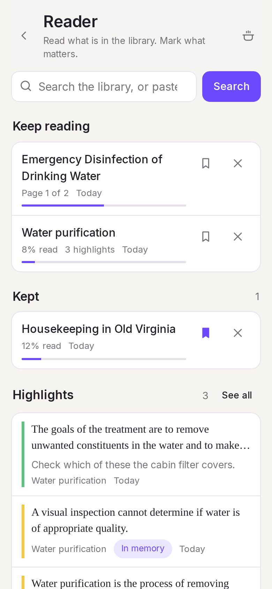
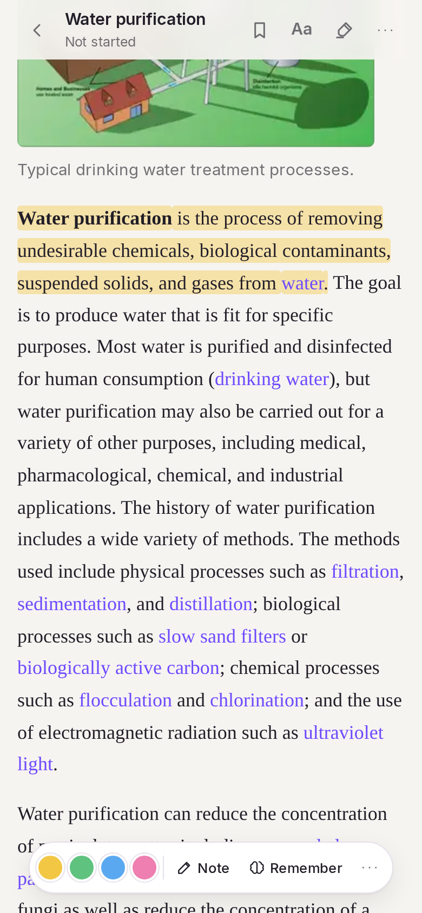
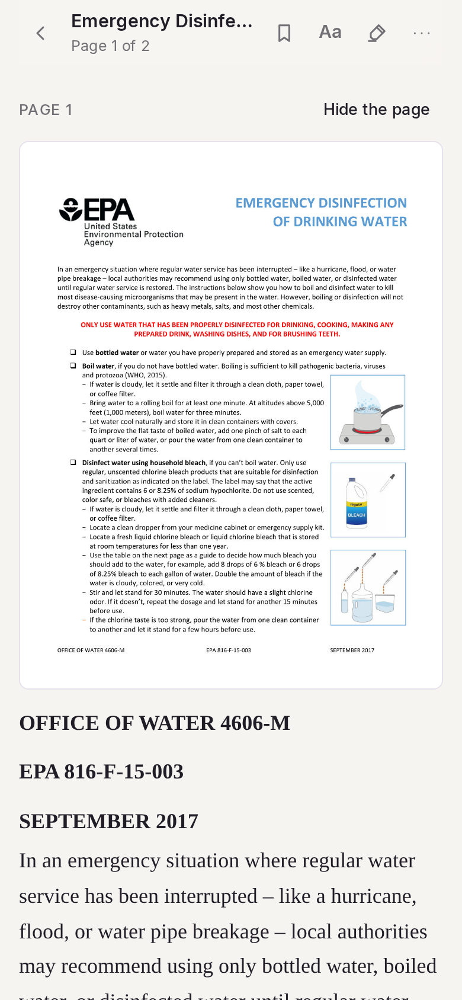
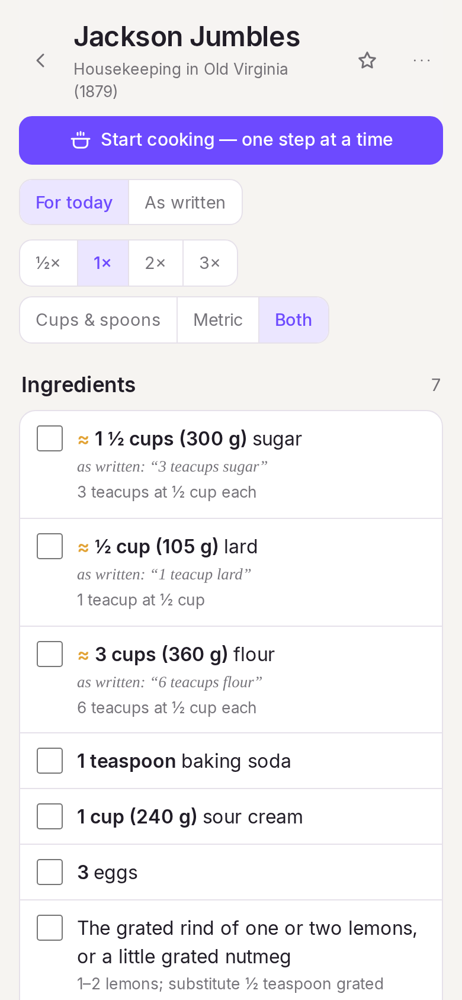
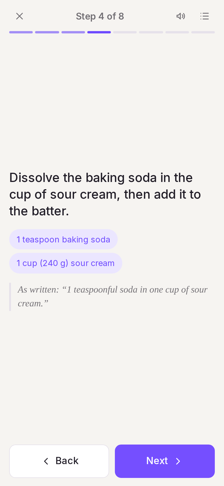

# Reader and Kitchen

Two pages built on the [offline library](offline-library.md):

- **Reader** (`/read`) opens anything in the library — an encyclopedia
  article, a field manual, a book, a document you added — on Aegis's own page,
  in one quiet column. You can highlight, write notes, keep your place, and
  hand what matters to Aegis's memory so it is there in later conversations.
- **Kitchen** (`/kitchen`) takes a recipe — pasted, picked out of a library
  page, or from a web page — and sets it out for cooking: the original
  wording, the measures worked out for today, and the method one step at a
  time. Old recipes are the point: "butter the size of an egg" and "a quick
  oven" are translated, and marked as the estimates they are.

Both work on a phone first, need nothing from the internet, and keep
everything per account.

| | |
|---|---|
|  |  |
|  |  |

## Reader

### Getting to something

- **From a chat.** When Aegis cites the library, the link opens in the reader
  (in the full app, in a new tab so the chat stays where it is).
- **From the shelf** (`/read`): search the library, pick up what you were
  reading, or walk **the library, by shelf** — categories, then shelves, then
  the books and documents on each (cookbooks by style, history and literature
  by era, manuals by skill; see [the shelves](library-shelves.md)). A search
  shows books and documents *by that name* first, then the passages found in
  the texts; a search from inside a shelf stays in it. *By collection* is the
  plain list of collections; one made of documents lists them by title.
- **By link**: paste a library link into the search box.

### Reading

The **Aa** button sets text size, serif or sans, the paper (auto, light,
sepia, dark) and the column width; the choice is kept in that browser.

An **article** arrives as the library's HTML cut down to its text, tables,
pictures and links. Links to other pages of the same collection open in the
reader; links to the web are marked ↗ and open in a new tab.

A **document** (a PDF in a collection, or one you added) is shown page by
page as text, its lines joined back into paragraphs, so it reads comfortably
on a phone. **Show the page** puts the picture of the printed page above the
text — for figures, tables and anything where the layout matters — and *Show
each page as printed* in **Aa** does it for every page. Pages load as you
scroll; *More → Go to a page* jumps.

Your place is remembered (the page of a document, how far down an article).
The bookmark keeps something on the shelf under *Kept*.

Not everything can be shown: a collection's front page that is drawn by
script (the Gutenberg catalogue, the zimgit collections) says so and offers
the library's own viewer instead. Books and documents inside those
collections open normally — find them by searching, on their shelf, or under
the collection's documents. Your own PDFs and e-books (copied into the
library folder) open the same way; an e-book is shown page by page on a
fixed page size, so a place in it can be kept and linked.

### Highlights and notes

Select text and a bar appears: four colours, **Note**, **Remember**, and ⋯
(*Cook from this*, *Copy*). Tap a highlight to change its colour, add or edit
the note, give it to memory, or delete it. The highlighter button in the top
bar lists the highlights in what you are reading; *Highlights* on the shelf
lists all of them, and *Save as a file* exports them as Markdown.

A highlight is stored as a range of characters within the article (or within
one page of a document), together with the words themselves and a little of
what surrounds them. If the text has moved since — the library was updated —
the words are looked for again; if they are gone, the highlight stays in your
lists and says so.

### Giving a highlight to memory

**Remember** files the passage — with your note and where it came from — as a
note in one of your topics in [deep memory](memory-and-users.md): the topic
you name, or one called after what you were reading. From then on it is part
of what Aegis knows about that topic and can come up in later conversations.
It appears under *What Aegis knows about me* (`/mind`) like everything else,
marked *Highlighted while reading*, with a link straight back to the passage,
and can be edited or deleted there. Nothing is given to memory unless you
press Remember.

## Kitchen

### Adding a recipe

- **Paste it**, or give a **link** (a web page when the server is online, or a
  library link): *Kitchen → Add a recipe*.
- **From the reader**: select the recipe in a cookbook and choose ⋯ → *Cook
  from this*; or *More → Cook from this page*.
- **Ask**: "Here's a recipe for jumbles from 1879, help me follow along" —
  the assistant saves it with the `manage_kitchen` tool and replies with the
  link.

A recipe page on the web usually carries the recipe as data (schema.org);
when it does, that is what is read, not the story around it.

### What you get

- **For today**: each ingredient as an amount in cups and spoons and in grams
  or millilitres, with ½× / 1× / 2× / 3× scaling and a units switch. An
  amount that was a judgement in the original carries **≈** and the original
  wording under it. The method is numbered, with the minutes and the oven
  temperature (°F and °C) where the recipe gives or implies one. *Good to
  know* holds what a modern cook needs that the recipe leaves out.
- **As written**: the original text, untouched, with its source.
- **Start cooking**: one step at a time in large type — the ingredients that
  step uses, a timer for its minutes (several can run at once; a chime and a
  vibration when one ends), the oven setting, the original wording of that
  step. Swipe or tap to move, the screen stays awake, and the speaker button
  reads each step aloud. Leave and it carries on where you were.



### Where the numbers come from

A model reads the recipe and separates it into ingredients and steps. The
numbers are then worked out by code, the same way every time
(`services/reader/kitchen.py`):

- units are converted exactly (1 cup = 236.6 ml, 1 oz = 28.35 g, °C from °F
  to the nearest 5);
- grams for an amount given by volume come from the usual weight of a cup of
  that ingredient (flour 120 g, sugar 200 g, butter 227 g, …) and are shown
  as *about*; an ingredient not in the table gets millilitres only;
- old measures use one table — a teacup ½ cup (some books mean ¾), a gill ½
  cup, a wineglass ¼ cup, a dessertspoon 2 teaspoons, butter the size of an
  egg ¼ cup, a slow / moderate / quick oven 300–325 / 350–375 / 400–450 °F —
  which is also given to the model, so the two agree. The same table writes
  the explanations under *Good to know*.

Treat estimates as estimates: a teacup was not a standard, and flour is not
packed the same way twice. The original is always one tap away.

With no model available the recipe is still kept: as written, a line per
step, with the old words explained, and a note saying that is all it is.
*More → Set it out again* redoes it later.

## For administrators

- Everyone signed in may use both pages; the library has to be switched on
  for the reader to open anything.
- `manage_kitchen` belongs to the *home* tool group, with lists, reminders,
  trackers and boards: a role that has the group has the tool.
- Shelves, highlights and recipes are rows owned by an account
  (`reader_items`, `reader_marks`, `kitchen_recipes`); deleting an account
  with its data removes them.
- Page pictures of documents that live inside a collection need the PDF as a
  file; it is copied to `data/reader_cache/` the first time and dropped again
  when the folder passes 1.5 GB.

## What keeps it safe

Library pages are other people's HTML, shown on the same origin as the app,
so:

- an article is rebuilt from an allow-list of tags and attributes
  ([nh3](https://github.com/messense/nh3)): no script, no event handlers, no
  styles, no frames, forms or embedded objects. The page's
  Content-Security-Policy would refuse script anyway;
- pictures come through `/api/reference/asset`, which serves images only.
  SVG (formulas, diagrams) is served only to an ``
  (`Sec-Fetch-Dest: image`), and every response from that path carries
  `default-src 'none'; sandbox`, set by the route and again by the middleware;
- a link only ever supplies a collection and a path inside it. The page is
  always fetched from the configured library server, whatever host the link
  names, and a path cannot climb out of its collection;
- a recipe link to the web goes through the same guarded download as library
  additions: public addresses only, checked again on every redirect.

## API

```
GET    /api/reader/where                       which links are library links
GET    /api/reader/shelf                       kept, recent, latest highlights
GET    /api/reader/open?u=…|b=…&p=…[&page=N]   open something ({"problem", "original"} when it cannot be shown)
GET    /api/reader/items/{id}/pages?first=N    more pages of a document
GET    /api/reader/items/{id}/pages/{n}/image  a page as a picture (JPEG)
PATCH  /api/reader/items/{id}                  {"page" | "position" | "pinned"}
DELETE /api/reader/items/{id}                  off the shelf, with its highlights
GET    /api/reader/marks[?item=…]              highlights
GET    /api/reader/marks/export[?item=…]       … as Markdown
POST   /api/reader/items/{id}/marks            {"page","start","end","quote","prefix","suffix","note","color"}
PATCH  /api/reader/marks/{id}                  {"note","color"}
DELETE /api/reader/marks/{id}
POST   /api/reader/marks/{id}/remember         {"topic"} → a note in deep memory
GET    /api/reader/collections                 collections, with how many documents each holds
GET    /api/reader/collections/{id}/documents?q=&offset=
GET    /api/reader/shelves                     the tree: categories, shelves, how much is on each
GET    /api/reader/shelves/contents?shelf=&q=&offset=   what is on one shelf
GET    /api/reader/find?q=                     books and documents by title or author

GET    /api/kitchen/recipes
POST   /api/kitchen/recipes                    {"text"} or {"url"}; optional "title"
GET    /api/kitchen/recipes/{id}
GET    /api/kitchen/recipes/{id}/text          as Markdown
PATCH  /api/kitchen/recipes/{id}               {"title","favourite","year"}
POST   /api/kitchen/recipes/{id}/redo          set it out again from the original
DELETE /api/kitchen/recipes/{id}
```

## Code

| | |
|---|---|
| `services/reader/content.py` | library page → safe HTML; document pages → paragraphs; page pictures |
| `services/reader/shelf.py` | shelf, place, highlights, export, handing a highlight to memory |
| `services/reader/kitchen.py` | setting a recipe out; units, weights, ovens, times; the cookbook |
| `services/reader/models.py` | the three tables |
| `routes/reader_routes.py` | the API |
| `src/agent_tools/reader_tools.py` | `manage_kitchen` |
| `static/lite/read.{js,css}`, `static/lite/kitchen.{js,css}` | the pages |
| `static/js/readerLinks.js` | library links in a chat open in the reader |
| `tests/test_reader.py`, `tests/test_kitchen.py` | |
