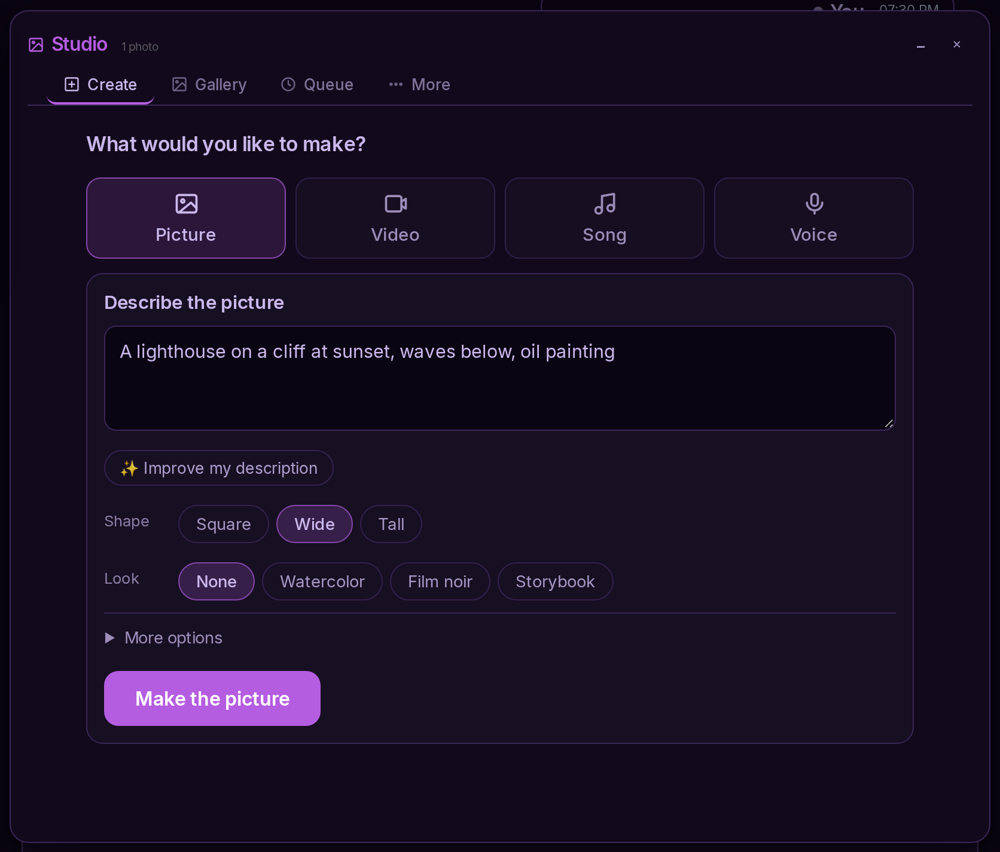
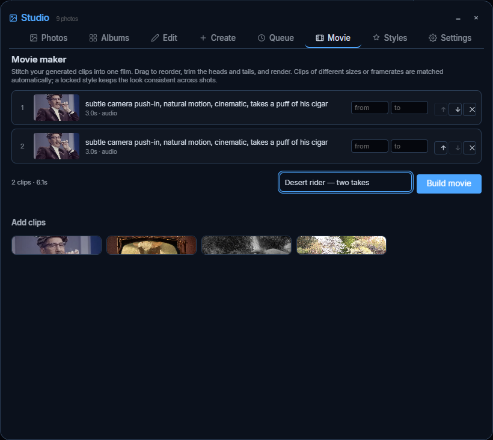
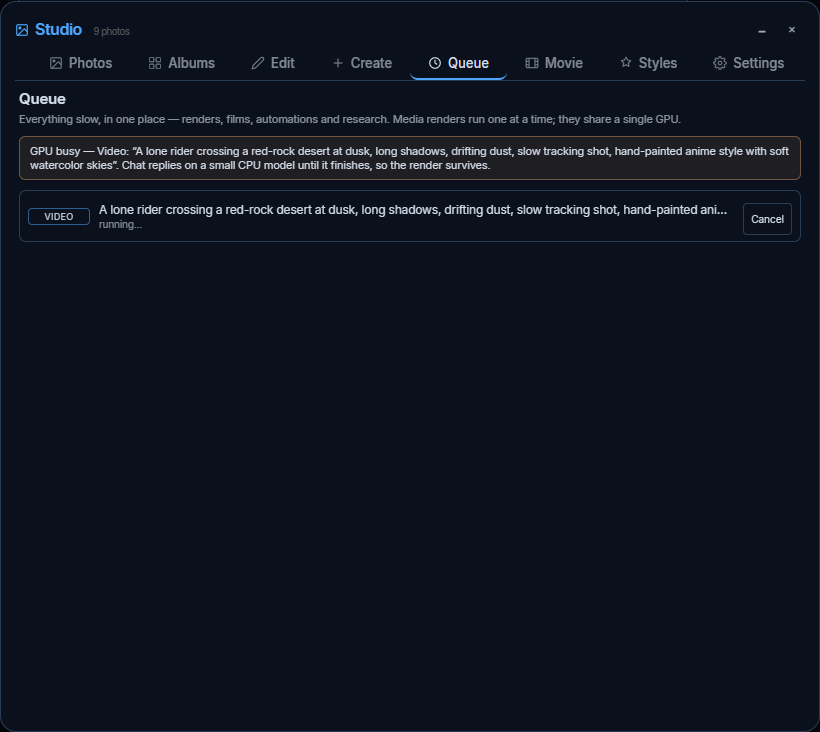
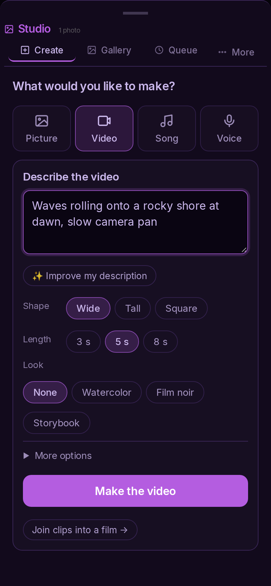

# Studio — make, keep, edit, stitch

The Studio is where pictures, videos, songs and voices get made, and where they
live afterwards.

Open it from the sidebar, with `/studio`, or `/open Studio`. (It used to be called
the Gallery — `/gallery` still works.) It opens on **Create**.

| Tab | What it is for |
|---|---|
| **Create** | Make a picture, a video, a song or a voice — describe it, press one button, watch it arrive. |
| **Gallery** | Everything you have made or added. Open one to edit it, animate it, change it, or put it in an album. |
| **Queue** | What is being made right now and what was made lately, with Cancel. |
| **More** | Albums, the Editor, the Movie maker, Music & voices (covers, narration, recording a voice), Styles, Settings. |

---

## Create

1. **Pick what to make**: Picture, Video, Song or Voice.
2. **Describe it.** Everything else has a default. *Shape* (square, wide, tall),
   *Length* and *Look* (your style presets) are one tap each; the rest — which
   model, a seed, steps, what to leave out — is under **More options**.
   "Automatic" picks the model this server is set up to prefer, and choosing
   one shows what that model is and what it is best for.
3. **Press the button and stay where you are.** The work appears below with its
   progress, the time so far and a **Cancel** that really stops it. When it is
   done the result is right there: play it, **Save** it, **Open** it in the
   Gallery, or carry on from it —
   - **Animate it** turns a picture into a video that starts on that frame;
   - **Change it** edits a picture by instruction ("make it winter") and keeps
     the original;
   - **Use these words again** puts the description back in the box.

Several things can be queued one after another; they are made one at a time
(one graphics card). Close the Studio and come back: the list is still there.
Each kind keeps its own draft, so a song's description never turns up as a
picture's.

If nothing is set up for a kind — no picture model, no voice — Create says so
instead of offering a button that fails.

Two things that make results much better:

- **Describe the scene, not the task.** Diffusion models depict; they don't
  obey. Ask for *"a movie trailer in the style of Studio Ghibli"* and the model
  will literally draw an ornate screen with a blurry movie playing on it
  (observed). Ask instead for what the camera sees: *"a lone rider crossing a
  red-rock desert at dusk, long shadows, slow tracking shot, hand-painted anime
  style."* **✨ Improve my description** does this rewrite for you with the
  local utility model.
- **A "trailer" is several shots, not one clip.** Make each shot (with one
  *Look* so they match), then join them under More → Movie maker.

Length goes up to ~10s on LTX models (24fps) and ~16s on Wan (16fps) — the
engine caps at 257 frames either way. All video is stored as **MP4** (renders
that come out of the engine as webm are transcoded automatically).

**Voice** speaks a piece of text in the voice you pick and hands you the
recording; it is not kept in the Gallery, so use Save. Recording your own
voice, narration with several speakers and song covers are under More → Music
& voices.

## Voices, and answers read aloud

A voice is recorded in the Voice Lab (Music → *Covers, narration and voice
recording*): about ten seconds of someone reading, under a name. From then on
it can speak anything typed under **Create → Voice** — and it can read the
assistant's answers aloud.

**A recorded voice is the sound of a person, so it belongs to one.** It is
its maker's, and reads only to them, until they press *Share with everyone at
home*; *Stop sharing* takes it back. Nobody else is read to in it, by any
route, and only its owner (or an administrator) can replace or delete it. A
voice from before owners were kept is the administrators' until one of them
takes charge of it. The record is `voices.json` beside the samples
(`services/tts/reading.py`).

**Reading aloud is each person's own choice**, kept with their account:

- *Read to me in this voice* on a voice in the Voice Lab, or Settings →
  Appearance → *Reading aloud*, or (on the family screen) the account sheet →
  *Reading aloud*. The choices are this device's own voice and every recorded
  voice that is theirs to use.
- A speaker sits under every answer; tap it to hear the answer, again to stop.
  *Read answers aloud* (the + menu, or the same card in Settings) reads every
  answer by itself, starting while it is still being written.

**A cloned voice can be slower than speech on a server like this one, and the
reader is built for that.** Measured here on the processor, the standard
Chatterbox makes a second of speech in about two (0.57× real time; 0.89× on
the graphics card) and Qwen3-TTS 0.19×; Chatterbox Turbo, run the way the
engine runs it, makes two seconds of speech in one (see *The faster model*
below). So an answer is not sent off whole: it is cut into pieces of about a sentence,
the pieces are made in order (`POST /api/tts/say`, off the event loop — making
speech used to hold up the whole app), and the reading starts when enough is
ready that it will not run dry before the end. While it prepares, the speaker
shows the moving mark and a line says how it is getting on: *Getting the voice
ready (2 of 7), about 9 s*. A voice that keeps up with itself starts at once;
a second listen is instant, because what was made is kept. A device's own
voice needs none of this and starts immediately. Each voice's pace is measured
from the pieces actually made (`tts_pace.json`) and shown where the voice is
chosen. The reader is one module for both screens: `static/js/readAloud.js`.

**The faster model.** The cloning engine (`engine/chatterbox/server.py`)
speaks with Chatterbox Turbo when that model's files are already on the server
and with the standard Chatterbox otherwise (`--model auto`, the default;
nothing is fetched to decide). Fetch Turbo once, 4 GB, with
`scripts/setup-engine.sh --tts-turbo` or
`hf download ResembleAI/chatterbox-turbo`; the next time the engine starts it
uses it. Same recordings, same voices: each model keeps what it prepared from
a recording in a file of its own beside it (`<name>.wav.voice.pt`,
`<name>.wav.turbo.pt`).

As shipped, Turbo was only a little quicker here than the standard model
(0.72× real time against 0.57×). Speech is made one token at a time, and each
token is one row pushed through 96 wide layers; in single precision that
product runs on a single core whatever the thread count, and it was
three-quarters of all the time spent. The engine does those products a row at
a time with the weights in half precision instead, which the processor spreads
over its cores: 2.2–2.4× real time on 16 cores, measured with a recorded voice.
Against the exact arithmetic over one sentence, the likeliest next token was
the same at every one of 245 steps. The engine tries the change on one layer
when the model loads and keeps it only where it is quicker and agrees (its
`/health` says what it measured); it is not made on a graphics card. `--exact`
switches it off, and `--model standard` goes back to the original model.

**As loud as before.** Turbo levels the reference recording down before it
reads the voice from it, and then speaks at about -28 LUFS: half as loud as
the standard model from the same recording (-22). The engine brings every
piece to the same loudness before sending it (`--loudness`, -22 LUFS by
default; a plain change of volume, held back where a piece's loudest moment
would clip), so the two models sound alike and one sentence is as loud as the
next. `--loudness 0` leaves each piece as the model made it.

**Having the voice ready.** The model swapper puts the cloning engine away
after five idle minutes, and the first piece after that waits five to ten
seconds for it to load. When the answer on its way is going to be read aloud
(answers are read by themselves, or the question was spoken on the family
screen), the screen says so as the question is sent (`POST /api/tts/warm`) and
the engine loads while the answer is being thought about. Only a recorded
voice is warmed, at most once in four minutes, and never one that has just
spoken; a tap on a speaker after a long pause still waits for the engine.

## Gallery & Albums

Everything you make lands here next to your own uploads: pictures, video clips,
songs and finished films — by itself, as soon as it is done. Search by
description or tag, filter by source model, and let a local vision model
auto-tag the lot (More → Settings → AI Tagging).

Open a picture for **Edit**, **Animate** and **Stylize** (the last two take you
to Create with that picture as the starting point), and the one-step fixes:
upscale, restore, redraw.

## Editor

Masked inpaint, background removal, upscaling, and full-image instruction edits,
driven by a served edit model.

---

## Movie

Local models make short clips — 2 to 10 seconds. The **Movie maker** (under More)
stitches several into one film; it also has a clip maker of its own.

Click clips to add them, drag rows to reorder (or use ↑/↓), and set **from**/**to**
on any row to trim its head and tail. Leave them blank to use the whole clip. The
bar shows the running total. Give it a title, hit **Build movie**, and the film
lands in your Studio like any other clip.

Worth knowing:

- **Mismatched clips are fine.** Wan and LTX render at different sizes and
  framerates. Every clip is scaled and padded to one canvas (the largest) and
  resampled to one framerate (the highest), then re-encoded. That's slower than a
  straight copy but it always works — the ffmpeg concat *demuxer* silently
  requires identical streams, which generated clips rarely are.
- **Mixed audio is fine.** LTX-2 emits audio; Wan doesn't. Silent clips get a
  generated silent track so the film keeps audio from the clips that have it,
  instead of dropping it everywhere.
- **Style is what makes it a film.** Activate a preset (Studio → Styles) before
  generating your shots and they share a model, seed, prompt affixes and LoRAs —
  which is what makes separate clips read as one piece rather than a pile.
- It's ffmpeg on the CPU, so building a film doesn't compete with a render for
  the GPU. Both can run at once.

## Styles

A preset locks a model, prompt prefix/suffix, negative prompt, seed, steps, CFG,
size and LoRAs into a named look. Activate one and every image and video
generation matches it, until you turn it off. Also drivable with `/style`.

## Queue

One list of everything slow: renders, films, automations, and research. It shows
what's running with progress, what's next in line, what recently finished (with a
link to the result), and a cancel button on anything live. Cancel stops the
render itself — a video, a song or a picture edit — not just the entry.

Media renders run **one at a time** — they share a single GPU.

---

## Chat while a render runs

This one is worth understanding, because the naive version silently destroys work.

A diffusion model fills the card (Qwen-Image sits at roughly 23.6GB of a 24GB
4090), and llama-swap resolves model contention by **eviction**. So a chat message
during a render would stop the image/video server mid-job to load your chat model.
The render dies, and nothing tells you why.

There is no VRAM left to share, so Aegis takes the only option that works: while a
render is live, chat is answered by **`chat-lite-cpu`** — a small model pinned
entirely to the CPU (`--device none`, so it takes no VRAM at all, not even a CUDA
context). Chat says so in the reply header, and goes back to your real model the
moment the GPU frees up.

Two pieces make that work, and both are needed:

- `engine/llama-swap.yaml` puts `chat-lite-cpu` in a group with
  `exclusive: false` (loading it never evicts a render) and `persistent: true`
  (a render never evicts it). Without the group, llama-swap evicts either way.
- The app checks the queue before each turn and routes accordingly.

**Turning it off:** set `gpu_busy_fallback` to `off` in settings. Chat then always
uses your selected model — and a message sent during a render will kill it.

**Using a different fallback:** point `gpu_busy_fallback_model` at another
llama-swap alias. It must be in a non-exclusive, persistent group and should be
CPU-only; if it isn't served, Aegis logs a warning and leaves chat alone rather
than handing you a 404.

Agent mode swaps too, and shrinks its context budget to the CPU model's window
(32K) — your coder model's 45K window would otherwise overflow it.

---

## On your phone

The Studio works at phone width — four labelled tabs, big buttons, the whole
window full-screen:

  

For remote use, pair Aegis with [Tailscale](https://tailscale.com): install it on
the PC and phone, then `tailscale serve 7000` publishes the app as
`https://<your-pc>.<tailnet>.ts.net` — real HTTPS (so the service worker and
Voice Mode's microphone work in Safari), visible only inside your tailnet, with
Aegis still bound to localhost. Add to Home Screen and it's an app.

---

## Under the hood

Style presets are JSON under `data/styles/`; films are built by
`src/video_editing.py` (ffmpeg from `imageio-ffmpeg` — Playwright's bundled build
lacks libx264 and the filters) and orchestrated by `src/movie_maker.py`. The queue
is `src/job_queue.py`, and the chat routing is `src/gpu_guard.py`. Clip paths are
confined to `data/generated_images/`, because ffmpeg will read whatever it's given.
